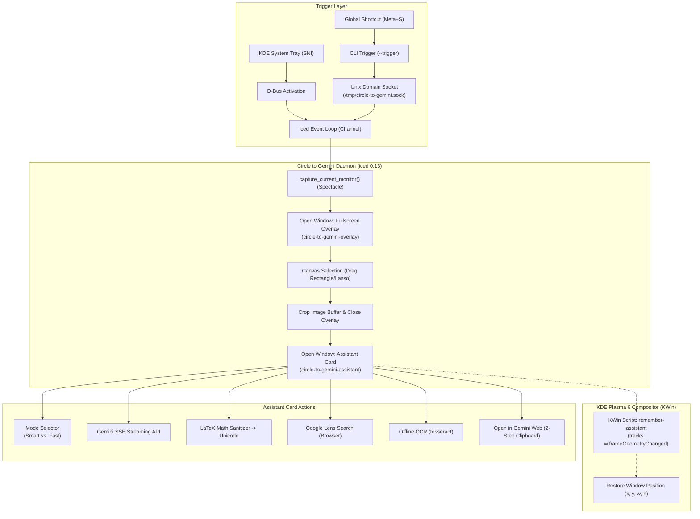

# Circle to Gemini — Technical Architecture & Implementation Documentation

> **Native Linux (KDE Plasma 6 / Wayland) counterpart to Android's "Circle to Search" and Google Gemini Screen Assistant.**
> Built in Rust using `iced 0.13`, Tokio, D-Bus, and the Google Gemini Multimodal REST / SSE Streaming API.

---

## 1. System Overview & Architecture

`circle-to-gemini` is designed as a resident background daemon with sub-millisecond invocation latency, zero Electron/Webview bloat, and full native Wayland compatibility.



---

## 2. Core Subsystems

### 2.1 Single-Instance Daemon & IPC
- **Socket Path:** `/tmp/circle-to-gemini.sock`
- **Mechanism:** On startup, the process attempts to bind the Unix domain socket.
  - If binding succeeds: It launches the daemon, starts the D-Bus StatusNotifierItem system tray icon, and listens for incoming connection triggers.
  - If binding fails (address in use): It connects to the existing socket, transmits a 1-byte capture trigger command, exits cleanly in <5ms, and releases control.
- **CLI Flag:** `circle-to-gemini --trigger` allows any desktop shortcut, script, or external automation tool to summon the assistant instantly.

---

### 2.2 Wayland Screen Capture & Freeze Overlay
- **Capture Backend:** Executed asynchronously in Tokio via KDE Spectacle:
  ```bash
  spectacle -m -b -n -o /tmp/screenshot.png
  ```
  This captures the active monitor directly under Wayland without interactive dialogs or flash effects.
- **Freeze Canvas:** The captured frame is loaded into an `iced::widget::canvas` spanning the screen.
- **Window Class Segregation:**
  - Application ID: `circle-to-gemini-overlay`
  - Window Level: `iced::window::Level::AlwaysOnTop`
  - Window Mode: `iced::window::Mode::Fullscreen`
  - Window Decorations: `false`
  - Styling: Semi-transparent dark wash over non-selected regions with a neon glowing Gemini border around the active selection rectangle.
- **Isolation Principle:** Because this window uses `circle-to-gemini-overlay`, window rules configured for the assistant card never interfere with screen selection.

---

### 2.3 Window Position Memory on Wayland

#### The Wayland Challenge
Under the `xdg_shell` protocol on Wayland, client applications are deliberately barred from querying their global screen coordinates `(x, y)` for security reasons. Consequently, client libraries like `winit` do not emit `WindowEvent::Moved` on Wayland, making standard in-app position restoration impossible.

#### The Solution: Native KWin Compositor Integration
We solved this by leveraging KDE Plasma's compositor-level APIs:

1. **Native KWin Script ([remember-assistant](file:///home/found/.local/share/kwin/scripts/remember-assistant/contents/code/main.js)):**
   - Hooks into `workspace.windowAdded` and `w.frameGeometryChanged`.
   - Filters exclusively for `w.resourceClass === "circle-to-gemini-assistant"`.
   - When the user drags or resizes the Assistant Card, the compositor captures its new geometry.
   - When the card is opened again, the script immediately sets `w.frameGeometry = savedPos`.

2. **KWin Window Rules ([~/.config/kwinrulesrc](file:///home/found/.config/kwinrulesrc)):**
   - Configured dedicated rule blocks with `positionrule=4` and `sizerule=4` (*Remember* policy).
   - Scoped strictly to `wmclass=circle-to-gemini-assistant` with baseline coordinates.
   - Scoped `circle-to-gemini-overlay` to `positionrule=1` (*Do Not Affect*) and `fullscreen=true`.

---

### 2.4 Mode Selector & Automated Model Cascading

The Assistant Card features a top-bar mode selector (**Smart** vs. **Fast**) that persists across sessions in `~/.config/ctg/circle-to-gemini/config.json`.

```
                    ┌─────────────────────────┐
                    │ User Prompt + Snippet   │
                    └────────────┬────────────┘
                                 │
                 ┌───────────────┴───────────────┐
                 ▼                               ▼
       ┌───────────────────┐           ┌───────────────────┐
       │    Smart Mode     │           │     Fast Mode     │
       └─────────┬─────────┘           └─────────┬─────────┘
                 │                               │
                 ▼                               ▼
       ┌───────────────────┐           ┌───────────────────┐
       │ gemini-3.8-flash  │           │gemini-3.5-flash-l │
       └─────────┬─────────┘           └─────────┬─────────┘
          503?   │                               │ 503?
                 ▼                               ▼
       ┌───────────────────┐           ┌───────────────────┐
       │ gemini-3.6-flash  │           │gemini-3.1-flash-l │
       └─────────┬─────────┘           └───────────────────┘
          503?   │
                 ▼
       ┌───────────────────┐
       │gemini-3.5-flash-l │
       └─────────┬─────────┘
          503?   │
                 ▼
       ┌───────────────────┐
       │gemini-3.1-flash-l │
       └───────────────────┘
```

- **Resilience:** If Google AI Studio returns a `503 Service Unavailable`, `429 Too Many Requests`, or `404 Not Found`, the engine automatically informs the user with an in-stream notification and seamlessly cascades down to the next model tier without dropping the query.

---

### 2.5 LaTeX Math Sanitization & Unicode Normalization

Standard Markdown engines do not render LaTeX math syntax. When Gemini answers technical questions involving equations, it outputs `$x_i$`, `$\sigma_i$`, and `$$...$$`.

`circle-to-gemini` implements a two-stage math rendering pipeline:
1. **API Prompt Instruction:** The `systemInstruction` payload instructs Gemini to format formulas using Unicode symbols and code blocks instead of dollar delimiters.
2. **Rust-Native Sanitizer (`sanitize_markdown_math`):**
   - **Inline formulas (`$...$`):** Strips delimiters and maps LaTeX syntax to Unicode characters:
     - Greek: `\alpha` $\rightarrow$ `α`, `\beta` $\rightarrow$ `β`, `\sigma` $\rightarrow$ `σ`, `\Sigma` $\rightarrow$ `Σ`, `\omega` $\rightarrow$ `ω`
     - Logic & Sets: `\forall` $\rightarrow$ `∀`, `\exists` $\rightarrow$ `∃`, `\in` $\rightarrow$ `∈`, `\subseteq` $\rightarrow$ `⊆`
     - Relations: `\le` $\rightarrow$ `≤`, `\ge` $\rightarrow$ `≥`, `\ne` $\rightarrow$ `≠`, `\approx` $\rightarrow$ `≈`
     - Subscripts/Superscripts: `_i` $\rightarrow$ `ᵢ`, `_{-i}` $\rightarrow$ `₋ᵢ`, `_1` $\rightarrow$ `₁`, `^2` $\rightarrow$ `²`, `^T` $\rightarrow$ `ᵀ`
     - Fractions/Roots: `\frac{a}{b}` $\rightarrow$ `a/b`, `\sqrt{x}` $\rightarrow$ `√(x)`
   - **Display equations (`$$...$$`):** Converts multiline equations into clean, syntax-highlighted code blocks.

---

### 2.6 Privacy & Memory Model
- **No Disk Logging:** Conversations are stored **strictly in volatile RAM** within the active `AssistantState` struct.
- **Session Cleanup:** When the assistant card is closed or the daemon is restarted, the message history is completely wiped. No logs, queries, or image crops are retained on disk.

---

### 2.7 Multi-Turn Conversational Memory
- The Assistant maintains continuous context across questions within the current card session.
- When you ask a follow-up, the full conversation history (alternating `user` and `model` turns) along with the initial crop attachment is packaged into the Gemini REST payload.

---

### 2.8 Browser Continuation Flow ("Open in Gemini Web")
Due to Wayland security boundaries, an external app cannot inject both a binary file and arbitrary text simultaneously into an active browser form.

We designed a two-step automated synchronization pipeline:
1. **Step 1:** The cropped screenshot is piped to the Wayland system clipboard as `image/png` using `wl-copy -t image/png`, and `https://gemini.google.com/app` is opened in the default browser.
2. The user switches to the browser tab and presses <kbd>Ctrl+V</kbd> to attach the image.
3. **Step 2:** An asynchronous Tokio timer (4.5s) automatically loads the complete conversational transcript onto the system clipboard.
4. The user presses <kbd>Ctrl+V</kbd> a second time to paste their text prompt.

---

### 2.9 KDE Plasma 6 Shortcut Registration
- Registered with `kglobalaccel` over D-Bus:
  - Component: `circle-to-gemini.desktop`
  - Actions: `_launch` and `Capture`
  - Key sequence: `268435539` (`Qt::MetaModifier (0x10000000) | Qt::Key_S (0x53)`)
- System cache refreshed via `kbuildsycoca6`.

---

## 3. Configuration & File Reference

| Purpose | File Path |
|---|---|
| **Executable Binary** | [`~/.local/bin/circle-to-gemini`](file:///home/found/.local/bin/circle-to-gemini) |
| **Application Config** | [`~/.config/ctg/circle-to-gemini/config.json`](file:///home/found/.config/ctg/circle-to-gemini/config.json) |
| **Desktop Entry** | [`~/.local/share/applications/circle-to-gemini.desktop`](file:///home/found/.local/share/applications/circle-to-gemini.desktop) |
| **Tray & App Icon** | [`~/circle-to-gemini/assets/gemini-icon-32.png`](file:///home/found/circle-to-gemini/assets/gemini-icon-32.png) |
| **KWin Window Rules** | [`~/.config/kwinrulesrc`](file:///home/found/.config/kwinrulesrc) |
| **KWin Position Script** | [`~/.local/share/kwin/scripts/remember-assistant/`](file:///home/found/.local/share/kwin/scripts/remember-assistant/) |
| **IPC Domain Socket** | `/tmp/circle-to-gemini.sock` |

---

## 4. Maintenance & Operations

- **Restart the background daemon:**
  ```bash
  killall -9 circle-to-gemini 2>/dev/null; rm -f /tmp/circle-to-gemini.sock; circle-to-gemini &
  ```
- **Test trigger from terminal:**
  ```bash
  circle-to-gemini --trigger
  ```
- **Recompile release binary:**
  ```bash
  cargo build --release --manifest-path ~/circle-to-gemini/Cargo.toml
  cp -f ~/circle-to-gemini/target/release/circle-to-gemini ~/.local/bin/
  ```
- **Reload KWin compositor configuration:**
  ```bash
  gdbus call --session --dest org.kde.KWin --object-path /KWin --method org.kde.KWin.reconfigure
  ```
